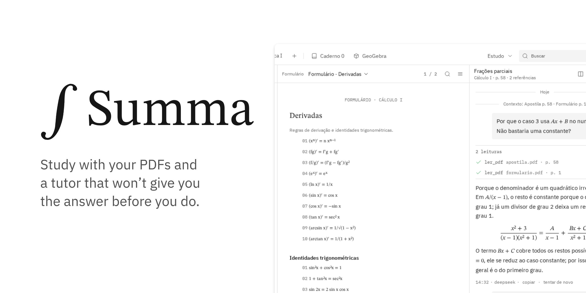
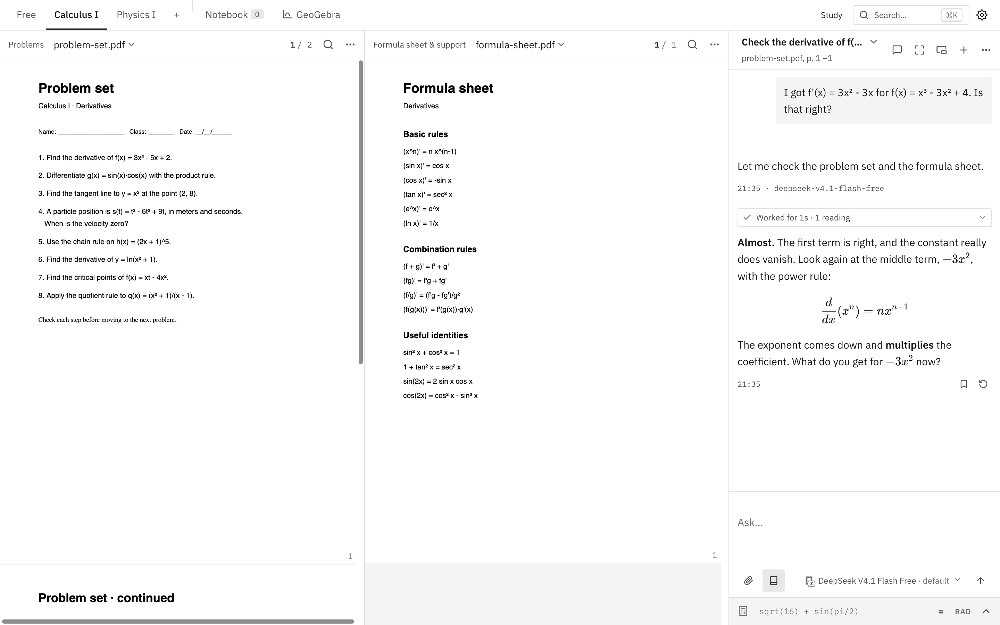

<p align="center">
  <picture>
    <source media="(prefers-color-scheme: dark)" srcset="docs/release-assets/v1.3.0/banner-readme-en-escuro.png">
    
  </picture>
</p>

<p align="center"><a href="README.md">Português</a> · <b>English</b></p>

# Summa

A local Electron app for studying with PDFs and an AI tutor in the same window. Handwriting stays in [Xournal++](https://xournalpp.github.io/) (or Ambitus, its version that reads handwriting through Summa) or another app of your choice; Summa has no ink canvas.

```
Summa                                   Xournal++ (or Ambitus)
  problem set + formula sheet (PDF)       handwriting
  tutor (OpenCode)                       your attempt
  calculator, GeoGebra, notebook          → Check sends the page to the tutor
```

The name is the same in both languages: **Summa**.

<p align="center">
  <picture>
    <source media="(prefers-color-scheme: dark)" srcset="docs/release-assets/v1.3.0/app-escuro-en.png">
    
  </picture>
</p>

## What it does

- **Two independent PDF readers** with search, bookmarks, an outline, and clickable "File.pdf, p. N" citations in the tutor's answers.
- **Tutor** with OpenCode, the visible and default engine; provider sign-in happens in the app and the account stays in OpenCode. The Claude Code code remains in the repository for tests and old sessions; Pi is retired, and old sessions open read-only.
- **Check** captures the window of your writing app and attaches it to the message; with Ambitus, it grabs the open page. **Phone photo** shows a QR code that opens a page on the same network, and photos arrive in Summa in the order you sent them.
- **Ambitus bridge:** with Summa open, Ambitus sends the handwritten page and gets the text back for the notebook search; the page also lands in the side chat or in the tutor tray. The side chat gains a clip, a tray and image pasting. To turn reading on, use **Settings → Summa features → Search the handwriting too** and a paid model with vision.
- **Tutor mini mode:** the conversation in a 360×480 window, always on top, to follow your work in Xournal++.
- **Figures, charts and interactive activities** in the chat, all working offline. GeoGebra on demand, with an optional offline pack.
- **PDF from the tutor:** problem list, handout, summary, mock exam and formula sheet, with an A4 preview and a review step before saving.
- **Notebook** (Review today), study **Statistics**, the **Summa guide** (⌘/) and a numeric calculator.
- **Free** tab for studying without a course; **Create a course** moves the conversation and its PDFs into a new tab.
- Interface and tutor in **English or Portuguese**, light or dark theme, and two accent colors (Graphite and Violet).

**Not included:** ink canvas, PDF editing, telemetry, cloud account. Sign-in happens in the app and the provider account stays in OpenCode; the OpenCode Zen free-model key, when used, is encrypted with the system keychain.

## Requirements

- Node **22+**, only to install from source (`npm ci`, `npm run setup`, `npm start`). The app and the tutor MCP server run on Electron's embedded Node, so studying does not depend on the system Node.
- **OpenCode 2.2.7** — Summa uses the copy already installed or downloads its own on first launch, with the package pinned. The Claude Code code still accepts the 2.1.296 through 2.1 series, but it is not shown in this release; old Pi sessions open read-only.
- Your course PDFs in any folder.
- macOS or Windows. Check works on both; with Ambitus connected, also on Linux. Day-to-day use has been tested by hand on macOS. On Windows, Electron needs the Microsoft Visual C++ Redistributable x64, and `npm run setup` shows the link if it is missing.

## Getting started

```sh
cd desk
npm ci
npm run setup
npm run doctor
npm start
```

On first launch, Summa walks you through one step at a time: language and color, how Summa works, course name, PDF folder (subfolders count), tutor, and done. The course is only created at the last step. OpenCode asks for your provider sign-in on first connection; the account stays in OpenCode, not in Summa.

`npm run doctor` checks the installed engine, policies, fonts, the visual extension (when applicable) and persistence without opening the app. On a Mac, `npm run install-app` builds **Summa.app**; on Windows, it installs per user into `%LOCALAPPDATA%\Programs\Summa`, with a Start Menu shortcut, its own icon and an entry in "Installed apps".

Installing with `npm run install-app` keeps using the clone's `desk/.runtime` (sessions, state and OpenCode), so do not delete or move the clone folder; to move it, use the backup (`desk/scripts/study-backup.mjs`, or the **Backup and share** panel) or don't move it.

For an agent setting up the computer: [`desk/SETUP.md`](desk/SETUP.md) (in Portuguese).

## Updating

**About → Update and restart** (from 0.4.0 on), or `npm run update` in `desk/`. Your `config.json` keeps working as it is. What changed in each version is in the [Releases](https://github.com/FariaDev/summa/releases) and in the [CHANGELOG](CHANGELOG.md).

If you installed from the old repository (`mesa-de-estudos`), reinstall once from Summa; the 1.3.0 release there says so.

## Settings

**Settings** (⌘ , / Ctrl+,): courses and folders, readers (one or two, their names and the starting PDF), visible features, appearance, the app that Check captures and the Ambitus handwriting reading. Changes apply when you save. To customize with an agent: [`docs/agents/customizar.md`](docs/agents/customizar.md) and [`desk/config.example.json`](desk/config.example.json).

## Problems

**Report a problem** (in the **Settings** menu, in the ⌘K palette or in the guide footer) or `npm run triage` builds a clean report, with no keys, sessions, course names or PDF names, and offers a ready prompt for an agent and a prefilled issue in the public repository [`FariaDev/summa`](https://github.com/FariaDev/summa) for you to review. The app log opens from About.

## Development

Code lives in `desk/` (the app), `core/` (invariants in Bend, with laws and proofs) and `visual-check/` (macOS capture). Gates and rules: [`AGENTS.md`](AGENTS.md). Most project docs are in Portuguese.

```sh
cd desk
npm run verify:bend
npm test
npm run ui
```

## Credits

- **Lucas Faria** — author

[MIT](LICENSE) license.
