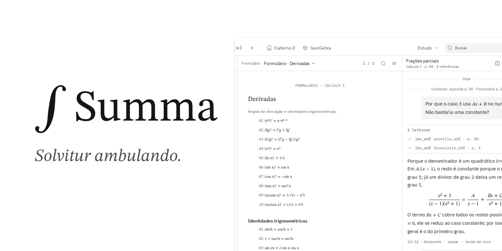
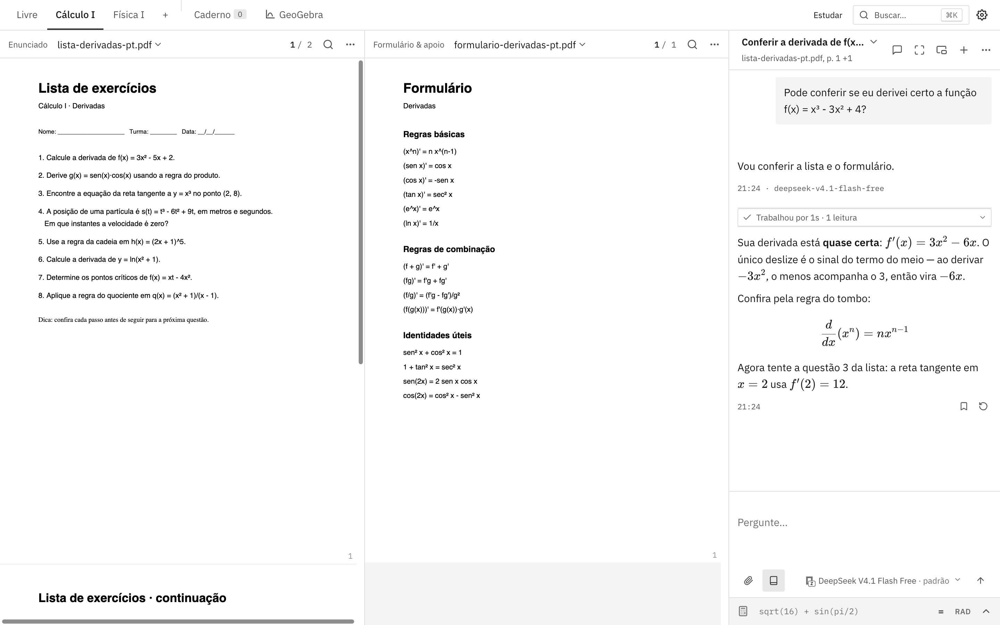

<p align="center">
  <picture>
    <source media="(prefers-color-scheme: dark)" srcset="docs/release-assets/v1.3.0/banner-readme-escuro.png">
    
  </picture>
</p>

<p align="center"><b>Português</b> · <a href="README.en.md">English</a></p>

# Summa

App local (Electron) para estudar com PDFs e um tutor de IA na mesma janela. A escrita à mão continua no [Xournal++](https://xournalpp.github.io/) (ou no Ambitus, a versão dele que lê a escrita à mão pela Summa) ou em outro programa de sua escolha; a Summa não tem canvas de tinta.

```
Summa                                   Xournal++ (ou o Ambitus)
  enunciado + formulário (PDF)            escrita à mão
  tutor (OpenCode)                       tentativa
  calculadora, GeoGebra, caderno          → Conferir manda a página ao tutor
```

O nome é o mesmo nas duas línguas: **Summa**.

<p align="center">
  <picture>
    <source media="(prefers-color-scheme: dark)" srcset="docs/release-assets/v1.3.0/app-escuro-pt.png">
    
  </picture>
</p>


## Linux — AppImage (x86_64)

Baixe `Summa-X.Y.Z-x86_64.AppImage` nos assets da [Release](https://github.com/FariaDev/summa/releases/latest),
guarde em uma pasta sua (por exemplo `~/Applications`) e execute:

```sh
chmod +x ~/Applications/Summa-*.AppImage
~/Applications/Summa-*.AppImage
```

Não precisa de Node nem npm. Ao abrir, a Summa cria/atualiza a entrada do menu e o
ícone em `~/.local/share` (respeita `XDG_DATA_HOME`). Não mova o arquivo depois
sem abri-lo novamente para atualizar o atalho. Os estudos ficam fora do AppImage,
na pasta de dados do usuário. O Sobre baixa e confere a atualização assinada e
substitui o mesmo arquivo; a pasta precisa ser gravável, sem sudo.

No Ubuntu 22.04+, instale `libfuse2` (ou `libfuse2t64` nas versões recentes).
Se FUSE não estiver disponível, abra com
`~/Applications/Summa-X.Y.Z-x86_64.AppImage --appimage-extract-and-run`.

## O que tem

- **Dois leitores de PDF** independentes, com busca, favoritos, sumário e citação "Arquivo.pdf, p. N" clicável nas respostas.
- **Tutor** com OpenCode, o motor visível e o padrão; o login do provedor acontece no app e a conta fica nele. O código do Claude Code continua no repositório para testes e sessões antigas; o Pi foi aposentado e sessões antigas abrem só para leitura.
- **Conferir:** captura a janela do programa de escrita e anexa à mensagem; com o Ambitus, pega a página aberta. **Foto do celular:** um QR code abre uma página na mesma rede, e as fotos entram na Summa na ordem de envio.
- **Ponte com o Ambitus:** com a Summa aberta, o Ambitus manda a página escrita à mão e recebe o texto para a busca do caderno; a página também entra no chat lateral ou na bandeja do tutor. Para ligar a leitura, use **Configurações → Recursos da mesa → Buscar também na escrita à mão** e um modelo pago com visão.
- **Modo mini do tutor:** a conversa numa janela de 360×480, sempre por cima, para acompanhar a resolução no Xournal++.
- **Figuras, gráficos e atividades interativas** no chat, que funcionam offline. GeoGebra sob demanda, com pacote offline opcional.
- **PDF pelo tutor:** Lista, Apostila, Resumo, Simulado e Formulário, com prévia em A4 e revisão antes de salvar.
- **Caderno** (Revisar hoje), **Estatísticas** de estudo, **Guia da Summa** (⌘/) e calculadora numérica.
- **Aba Livre** para estudo avulso, sem criar matéria; **Criar matéria** leva a conversa e os PDFs para uma aba nova.
- Interface e tutor em **português ou inglês**, tema claro ou escuro e duas cores de acento (Grafite e Violeta).

**Não entra:** canvas de tinta, edição de PDF, telemetria, conta na nuvem. O login acontece no app e a conta do provedor fica no OpenCode; a chave dos modelos grátis do OpenCode Zen, quando usada, fica cifrada no cofre do sistema.

## Requisitos

- Node **22+** só para instalar a partir do código (`npm ci`, `npm run setup`, `npm start`). O app e o servidor MCP do tutor rodam no Node embutido do Electron, então estudar não depende do Node do sistema.
- **OpenCode 2.2.7** — a Summa usa a cópia que já estiver instalada ou baixa a própria na primeira abertura, com o pacote fixado. O código do Claude Code ainda aceita a faixa 2.1.296 até a série 2.1, mas ele não aparece nesta versão; sessões Pi antigas abrem só para leitura.
- Os PDFs da matéria numa pasta qualquer.
- macOS ou Windows. O Conferir funciona nos dois; com o Ambitus conectado, também no Linux. O resto do dia a dia foi testado à mão no macOS. No Windows, o Electron precisa do Microsoft Visual C++ Redistributable x64, e o `npm run setup` avisa com o link se ele faltar.

## Começar

**No Windows**, baixe `Summa-Setup-X.Y.Z.exe` na [página de versões](https://github.com/FariaDev/summa/releases/latest) e abra o arquivo. Não precisa de administrador, Node nem terminal.

**No macOS**, baixe `Summa-X.Y.Z.dmg` na [página de versões](https://github.com/FariaDev/summa/releases/latest), abra a imagem e arraste **Summa** para **Aplicativos**. Não precisa de Node, npm nem clone.

O app ainda não é notarizado pela Apple. Se a primeira abertura mostrar **“Summa Not Opened”**, clique em **Concluído** e vá a **Ajustes do Sistema → Privacidade e Segurança → Abrir Mesmo Assim** (Open Anyway), na seção Segurança; confirme a abertura e autentique-se como administrador se solicitado. Depois, atualize por **Sobre → Atualizar e reiniciar**. Em uma instalação nova pelo DMG, os dados do app ficam em `~/Library/Application Support/Mesa de Estudos`; os PDFs ficam na pasta escolhida para a matéria. Quem migra do clone pode continuar usando o runtime antigo — não apague o clone sem fazer backup.

**A partir do código:**

```sh
cd desk
npm ci
npm run setup
npm run doctor
npm start
```

Na primeira abertura, a Summa mostra um passo por vez: idioma e cor, como a Summa funciona, nome da matéria, pasta de PDFs (subpastas contam), tutor e pronto. A matéria só é criada no último passo. O OpenCode permite entrar no provedor na primeira conexão; a conta fica nele, não na Summa.

`npm run doctor` confere o motor instalado, políticas, fontes, extensão visual (quando aplicável) e persistência sem abrir o app. No Mac, `npm run install-app` monta o **Summa.app**; no Windows, instala por usuário em `%LOCALAPPDATA%\Programs\Summa`, com atalho no menu Iniciar, ícone próprio e desinstalação em "Aplicativos instalados".

Quem instala com `npm run install-app` continua usando o `desk/.runtime` do clone (sessões, estado e OpenCode), então não apague nem mova a pasta do clone; para mudar de lugar, use o backup (`desk/scripts/study-backup.mjs`, ou o painel **Backup e compartilhar**) ou não mude.

Para um agente configurar o computador: [`desk/SETUP.md`](desk/SETUP.md).

## Atualizar

**Sobre → Atualizar e reiniciar** (de 0.4.0 em diante), ou `npm run update` em `desk/`. O `config.json` continua valendo como está. O que mudou em cada versão fica nas [Releases](https://github.com/FariaDev/summa/releases) e no [CHANGELOG](CHANGELOG.md).

Quem clonou o repositório antigo (`mesa-de-estudos`) precisa reinstalar uma vez pelo Summa; o aviso está na release 1.3.0 de lá.

## Configurações

**Ajustes → Configurações** (⌘ , / Ctrl+,): matérias e pastas, leitores (um ou dois, nomes e PDF inicial), recursos visíveis, aparência, o programa do Conferir e a leitura da escrita à mão do Ambitus. As mudanças valem ao salvar. Para personalizar com um agente: [`docs/agents/customizar.md`](docs/agents/customizar.md) e [`desk/config.example.json`](desk/config.example.json). O uso e os dados locais estão em [`desk/README.md`](desk/README.md).

## Problemas

**Relatar um problema** (no menu **Ajustes**, na paleta ⌘K ou no rodapé do Guia) ou `npm run triage` monta um relatório limpo, sem chaves, sessões, nomes de matéria nem de PDF, e oferece um prompt pronto para um agente e a issue já preenchida no repositório público [`FariaDev/summa`](https://github.com/FariaDev/summa) para você revisar. O log do app abre no Sobre.

## Desenvolvimento

Código em `desk/` (app), `core/` (invariantes em Bend, com leis e provas) e `visual-check/` (captura no macOS). Portões e regras: [`AGENTS.md`](AGENTS.md).

```sh
cd desk
npm run verify:bend
npm test
npm run ui
```

## Créditos

- **Lucas Faria** — autor

Licença [MIT](LICENSE).
